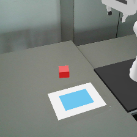
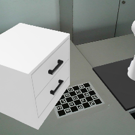
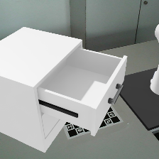
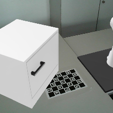
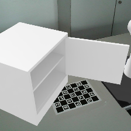
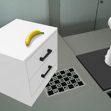
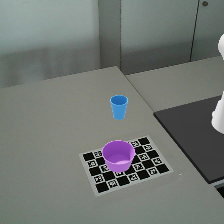

# Calibrated initial states

These previews are rendered through the same fixed camera and real-background
compositor used by the visual policy. They define the shared geometry consumed
by the ManagerBasedRLEnv task packages.

| Task | Initial-state contract | Closed | Fully open sweep check |
|---|---|---|---|
| Push cube to region | Red cube `7 x 7 x 5 cm`; randomized in the same XY/yaw range as the sugar box |  | Fixed `18 x 12 cm` target on A4 sheet |
| Drawer opening | Cabinet `(0.72, -0.18, 0)` m, yaw `35 deg`; upper handle `(0.611, -0.024, 0.280)` m |  |  |
| Cabinet opening | Door cabinet `(0.75, -0.18, 0)` m, yaw `35 deg`; handle `(0.721, 0.032, 0.262)` m |  |  |
| Banana to drawer | Same drawer cabinet; dynamic banana starts from a broad-side pose at `(0.663, -0.098, 0.3841)` m and settles near `z=0.3827` m |  | Same drawer sweep as above |
| Nut pouring | Cup `(0.43, -0.18, 0.001)` m; bowl `(0.52, -0.04, 0.001)` m; cup/bowl XY `+/-1.5 cm`, cup yaw `+/-8 deg`, separation `13--21 cm` |  | N/A |

The closed drawer and door handles are approximately 0.67 m and 0.72 m from
the Franka base respectively. At full opening they are approximately 0.58 m
and 0.43 m away. The closest horizontal distance from the Franka base center
to the moving drawer volume is approximately 0.36 m. Across the complete
0--100 degree door sweep, the moving door panel remains at least approximately
0.28 m from the base center. Both swept handle paths remain in the calibrated
policy view.

The banana now uses the official YCB visual mesh through a project-local PhysX
wrapper. It is a 0.066 kg dynamic rigid body with an eight-hull convex
decomposition, 0.8/0.6 static/dynamic friction, and zero restitution. A drop
test from 8 cm above the cabinet settled at `z=0.3827` m with 0.52 mm horizontal
drift and approximately 0.001 m/s residual linear speed. The preview above is
rendered after this physical settling rather than from a frozen visual pose.

The pouring vessels use 24 separate convex wall colliders plus a bottom
collider, so both remain physically hollow. The nut starts inside the cup and
is carried, poured, and caught through rigid-body contacts rather than an
episode-time pose override.
